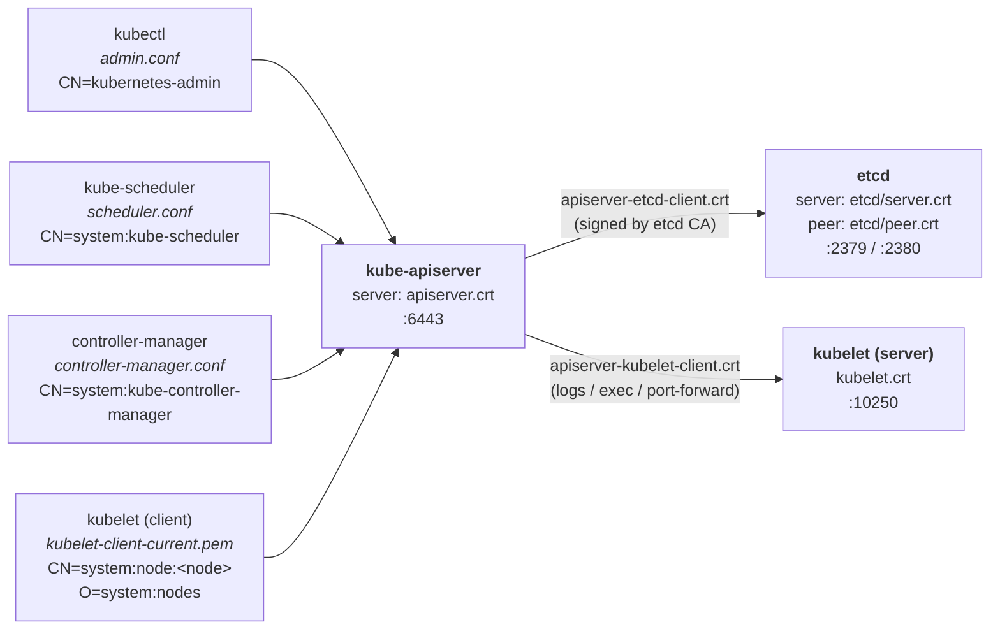

## Cluster PKI — who has which cert (kubeadm)

Rule: **everyone talks to the apiserver**; only the apiserver talks to etcd and to kubelets.
Only 3 real **servers**: kube-apiserver, etcd, kubelet. Everything else is a client.



### CAs (`/etc/kubernetes/pki/`)

| CA | Signs |
|---|---|
| `ca.crt` | apiserver, kubelets, admin, scheduler, CM, apiserver-kubelet-client |
| `etcd/ca.crt` | etcd server/peer/healthcheck, apiserver-etcd-client |
| `front-proxy-ca.crt` | front-proxy-client (aggregation layer, metrics-server) |

### Certs per component

| Component | Server cert | Client cert(s) → talks to |
|---|---|---|
| **kube-apiserver** | `apiserver.crt` (SANs: `kubernetes`, `kubernetes.default.svc...`, node IP, `10.96.0.1`) | `apiserver-etcd-client.crt` → etcd<br/>`apiserver-kubelet-client.crt` → kubelet<br/>`front-proxy-client.crt` → extension APIs |
| **etcd** | `etcd/server.crt` | `etcd/peer.crt` → other etcd members (HA)<br/>`etcd/healthcheck-client.crt` → probes |
| **kubelet** | `/var/lib/kubelet/pki/kubelet.crt` | `/var/lib/kubelet/pki/kubelet-client-current.pem` → apiserver |
| **scheduler** | — | embedded in `scheduler.conf` → apiserver |
| **controller-manager** | — | embedded in `controller-manager.conf` → apiserver (+ `sa.key` to sign SA tokens) |
| **admin / kubectl** | — | embedded in `admin.conf` → apiserver |

- Identity = cert **CN** (user) + **O** (group) → used by RBAC.
- `sa.key` / `sa.pub`: not a cert, a key pair to sign/verify ServiceAccount tokens (JWT).
- Leaf certs expire after **1 year** (CA: 10 years) → `kubeadm certs check-expiration` / `kubeadm certs renew all`.

```bash
openssl x509 -in /etc/kubernetes/pki/apiserver.crt -text -noout   # inspect (Subject, Issuer, SAN, dates)
openssl verify -CAfile ca.crt apiserver.crt                       # check it's signed by the CA
```